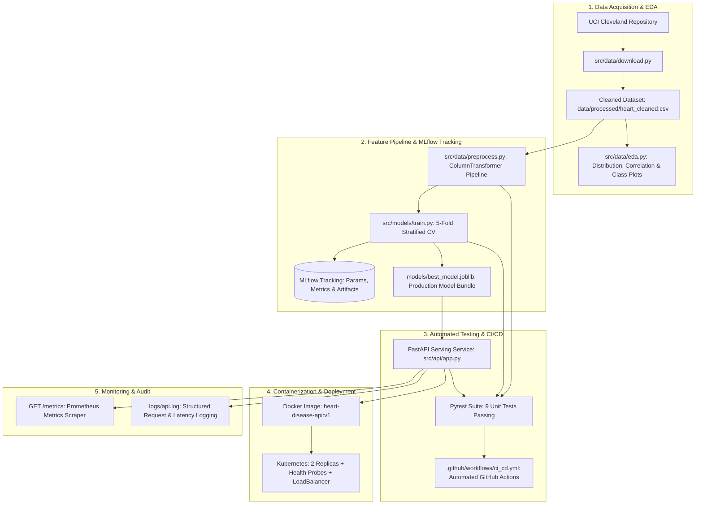

# End-to-End MLOps Solution: Heart Disease Risk Prediction

**Course:** BITS Pilani - AIMLCZG523 Machine Learning Operations  
**Assignment:** 01 (50 Marks)  
**Dataset:** [UCI Heart Disease (Cleveland Database)](https://archive.ics.uci.edu/dataset/45/heart+disease)

---

## 1. Project Overview & Architecture

This repository delivers an end-to-end, production-ready Machine Learning Operations (MLOps) pipeline for clinical risk prediction of heart disease using patient demographic and biometric health data.

### System Architecture Diagram



---

## 2. Project Directory Structure

```text
Assignment MLOps/
├── .github/
│   └── workflows/
│       └── ci_cd.yml                  # Automated GitHub Actions CI/CD Pipeline
├── data/
│   ├── raw/
│   │   └── heart.csv                  # Raw dataset downloaded from UCI
│   └── processed/
│       └── heart_cleaned.csv          # Cleaned dataset (303 records, binary target)
├── k8s/
│   ├── deployment.yaml                # Kubernetes 2-replica deployment with health probes
│   └── service.yaml                   # Kubernetes LoadBalancer service
├── logs/
│   └── api.log                        # Structured API request, latency & prediction logs
├── models/
│   ├── best_model.joblib              # Serialized winning pipeline (Logistic Regression)
│   └── model_metadata.json            # Model evaluation scores and metadata
├── notebooks/
│   └── 01_eda_and_modeling.ipynb      # Interactive Jupyter notebook for EDA & modeling
├── report/
│   ├── screenshots/                   # Generated EDA, ROC, and Confusion Matrix charts
│   ├── video_presentation_script.md   # Downloadable video presentation script
│   └── video_presentation_script.html # Printable HTML video presentation script
├── src/
│   ├── api/
│   │   ├── app.py                     # FastAPI app with /predict, /health, /metrics
│   │   └── schemas.py                 # Pydantic v2 schemas and request validation
│   ├── data/
│   │   ├── download.py                # Automated data acquisition & cleaning script
│   │   ├── eda.py                     # Visualizations & statistics generator
│   │   └── preprocess.py              # Scikit-learn ColumnTransformer pipeline
│   └── models/
│       ├── train.py                   # Model training & MLflow experiment tracking
│       └── predict.py                 # Standalone prediction module
├── tests/
│   ├── conftest.py                    # Pytest root path configuration
│   ├── test_data.py                   # Unit tests for data loading & cleaning
│   ├── test_model.py                  # Unit tests for pipeline & inference
│   └── test_api.py                    # Unit tests for FastAPI endpoints & validation
├── Dockerfile                         # Production containerization definition
├── .dockerignore                      # Docker ignore rules
├── .gitignore                         # Git exclusion rules
├── requirements.txt                   # Pinned reproducible dependencies
└── README.md                          # Full system documentation
```

---

## 3. Quick Start & Environment Setup

### 3.1 Prerequisites
- Python 3.12+
- Docker Desktop
- Kubernetes CLI (`kubectl`) & Minikube (or Docker Desktop Kubernetes)

### 3.2 Installation
```bash
# Clone the repository and navigate to root
cd "Assignment MLOps"

# Create and activate virtual environment
python -m venv .venv

# Windows PowerShell:
.venv\Scripts\Activate.ps1

# Linux / macOS:
# source .venv/bin/activate

# Install pinned dependencies
pip install --upgrade pip
pip install -r requirements.txt
```

---

## 4. Pipeline Execution Walkthrough

### Step 1: Data Acquisition & EDA
```bash
# Download and clean dataset from UCI
python src/data/download.py

# Generate EDA charts (saved to report/screenshots/)
python src/data/eda.py
```

### Step 2: Model Training & MLflow Experiment Tracking
```bash
# Train Logistic Regression and Random Forest models with 5-fold CV
python src/models/train.py

# Launch the MLflow UI
mlflow ui
# Open browser at http://127.0.0.1:5000 to inspect parameters, metrics, and ROC curves
```

#### Model Benchmark Summary
| Model | 5-Fold CV ROC-AUC | Test Accuracy | Test Precision | Test Recall | Test ROC-AUC | Status |
|---|---|---|---|---|---|---|
| **Logistic Regression (L2)** | **0.9025** | **88.52%** | **83.87%** | **92.86%** | **0.9665** | **Selected Best** |
| Random Forest (100 trees) | 0.8951 | 85.25% | 82.76% | 85.71% | 0.9426 | Baseline |

### Step 3: Run Automated Test Suite
```bash
# Execute unit tests with test coverage reporting
pytest tests/ -v --cov=src --cov-report=term-missing
```

### Step 4: Run FastAPI Serving Locally
```bash
uvicorn src.api.app:app --host 0.0.0.0 --port 8000 --reload
```
Interactive API docs available at: `http://localhost:8000/docs`

---

## 5. Docker Containerization

### 5.1 Build Docker Image
```bash
docker build -t heart-disease-api:v1 .
```

### 5.2 Run Container
```bash
docker run -d -p 8000:8000 --name heart-api heart-disease-api:v1
```

### 5.3 Test Inference Endpoint
```bash
curl -X POST http://localhost:8000/predict \
  -H "Content-Type: application/json" \
  -d '{
    "age": 63,
    "sex": 1,
    "cp": 3,
    "trestbps": 145.0,
    "chol": 233.0,
    "fbs": 1,
    "restecg": 0,
    "thalach": 150.0,
    "exang": 0,
    "oldpeak": 2.3,
    "slope": 0,
    "ca": 0.0,
    "thal": 1.0
  }'
```

**Sample JSON Response:**
```json
{
  "prediction": 0,
  "probability": 0.1859,
  "risk_level": "Low",
  "diagnosis": "Heart Disease Absent (Low Risk)",
  "model_version": "1.0.0"
}
```

---

## 6. Kubernetes Production Deployment

```bash
# Point shell to Minikube's Docker daemon (if running local Minikube)
& minikube -p minikube docker-env --shell powershell | Invoke-Expression

# Build image inside Minikube
docker build -t heart-disease-api:v1 .

# Deploy manifests to cluster
kubectl apply -f k8s/deployment.yaml
kubectl apply -f k8s/service.yaml

# Check rollout status
kubectl get pods -l app=heart-disease-api
kubectl get svc heart-disease-service

# Access service endpoint via Minikube tunnel
minikube service heart-disease-service
```

---

## 7. Monitoring & Logging

- **Prometheus Metrics:** Scrape `http://localhost:8000/metrics` for request counts, response latency histograms, and HTTP error rates.
- **Structured Request Logs:** All requests, status codes, and latency are recorded in `logs/api.log`.
